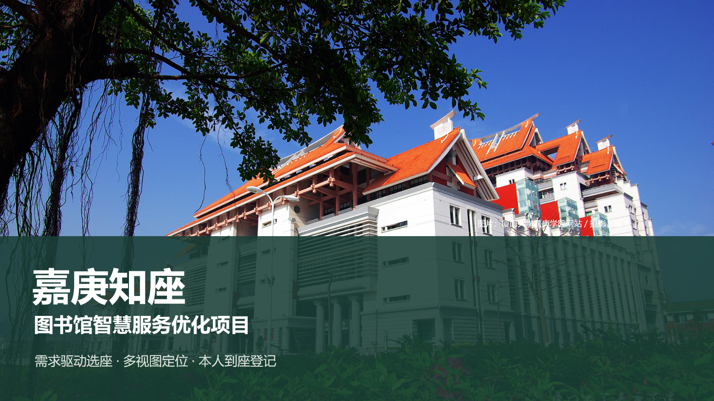
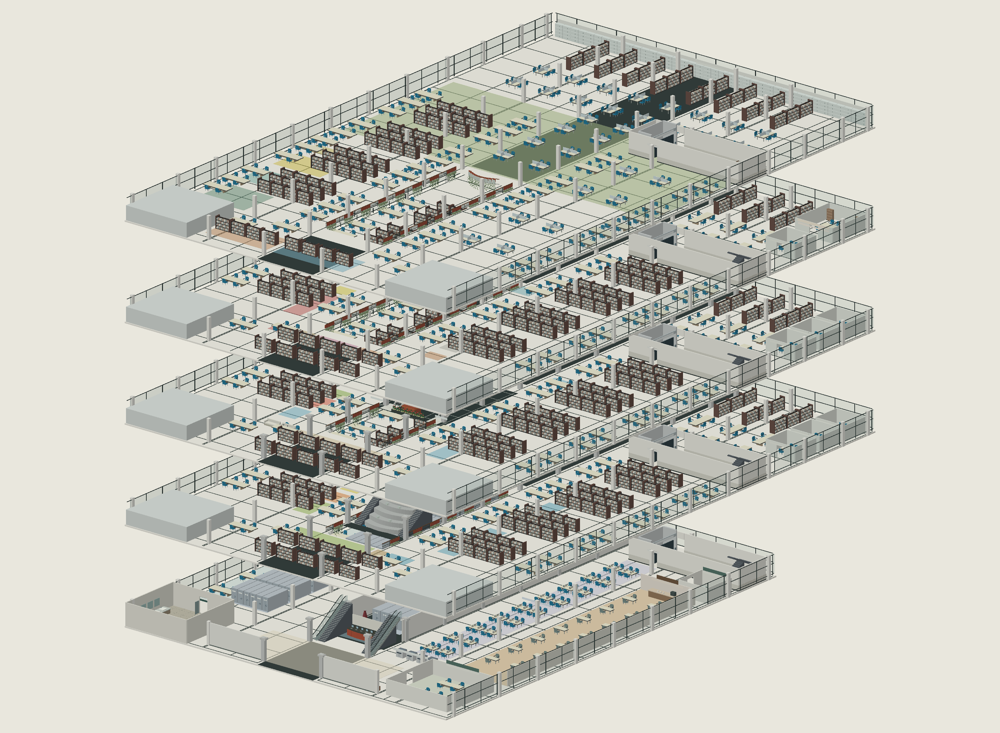
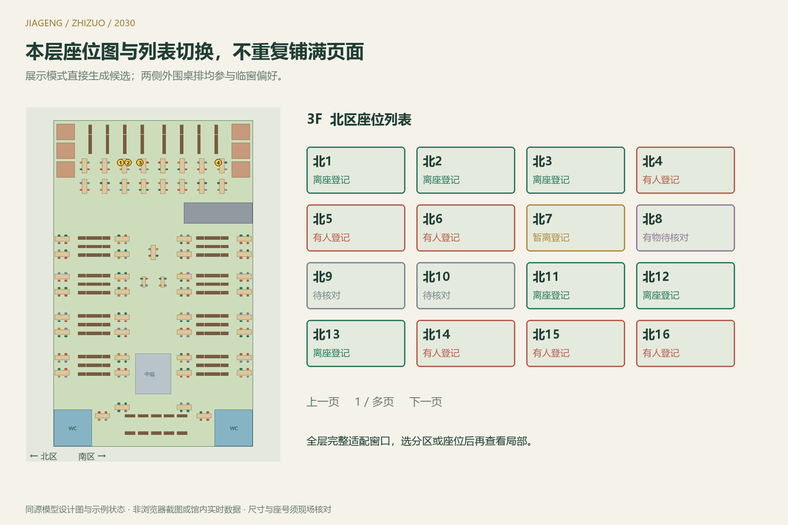

# 嘉庚知座

面向 2030 年的图书馆智能选座与学习资源联动原型。先表达本次学习需要，比较有依据的候选，再通过单层座位图和三维空间找到位置，到现场本人核对并登记。

## 正式汇报材料

46 页正式汇报稿，分别说明现有原型实现与后续数据接入、试点规划。

- [PowerPoint 演示文稿](docs/答辩展示/嘉庚知座_正式汇报版.pptx)
- [PDF 预览版](docs/答辩展示/嘉庚知座_正式汇报版.pdf)（图像页面，含章节与逐页书签）





## 项目做什么

- 五层独立入口，完整模型椅位目录与北、南、东分区。
- 主题、临窗、楼层、电源、打印条件，最多四个带理由与取舍的优先候选。
- 单层 SVG 座位图、16 项分页列表，一键定位优先区域或跳到所在页。
- 本人入座、暂离、离座与有物登记，过期回待核对，馆方专座优先保护。
- 可选语音转文字，解析后先确认条件；支持本机 Vosk 路线。
- Three.js 校园楼群、图书馆外观、完整空间、分层展开与五层平面；第一人称漫游和光影预设。
- 选座进入三维后，恢复原楼层、筛选、候选和查看位置，并重新核对候选有效性。



## 当前实现范围

主应用使用明确标注的合成展示记录或当前浏览器的本机自助登记。没有接入校内身份、正式预约、跨设备共享后台或全馆摄像头。近期离座登记只用于初筛，候选不等于已预约或已取得使用权。

模型生成目录为 1052 把椅位（104 / 208 / 220 / 208 / 312），不是学校官方座位数量。馆舍是根据导览、照片关系与现场说明逐步校准的相对示意，未作建筑测绘。三维承担定位辅助。

另保留 `规则与感知技术演示`，它使用 60 个合成样本研究观测、规则与图路线的组合。它与主应用的完整椅位目录分开。关键词条件提取和透明排序是规则实现；语音模型为公开预训练模型。

## 本地运行

安装 Node.js 和 npm，在仓库根目录执行：

```powershell
npm ci
npm test
npm run build
```

打开 `Demo/嘉庚知座.html` 体验主应用；`Demo/建筑与五层展示.html` 查看三维；`Demo/规则与感知技术演示.html` 查看独立研究页。构建后普通文字演示可直接打开 HTML，不需要后台常驻。

Node 包固定 `three 0.180.0`、`esbuild 0.25.10`。测试与构建以锁文件为准。程序使用原生 ES 模块组织源码，esbuild 将模块打入对应 HTML 模板。

### 可选本机语音

使用单独的 Python 环境安装 `src/requirements-voice.txt`，执行 `python src/prepare_voice.py` 下载官方中文模型，再运行：

```powershell
python src/voice_server.py --root .
```

通过终端给出的本机地址进入 Demo。服务只监听回环地址，录音在内存中识别；关闭终端或 Ctrl+C 停止，默认十分钟无活动退出。浏览器麦克风权限仍需使用者决定，文字输入始终可用。

私人研究照片、本人原声、人物参考与历史视频不随源码仓库分发。相关扩展面板需要自行放入有权使用的素材；缺少它们不影响文字选座与程序化馆舍几何。完整本人集成包另行保存。

## 代码结构

| 位置 | 责任 |
| --- | --- |
| `src/seat-page.js` + `seat-page.html` | 主页面、图表、分页、交互 |
| `src/seat-status.js` | 目录、登记状态、时效、资格与四优先 |
| `src/seat-voice.js` | 语音入口、中文规则提取、条件确认 |
| `src/seat-navigation.js` | 有限界面快照与三维返回 |
| `src/spatial.js` + `library-layout.js` | 共享坐标、楼板、书架、桌椅与区域 |
| `src/model*.js` | Three.js 场景、导览、清晰度、历史控制 |
| `src/photo-details.js` + `architecture.js` | 馆舍与程序化细节 |
| `src/walk.js` + `lighting.js` | 漫游、碰撞与光影 |
| `src/engine.js` + `data.js` + `app.js` | 独立 60 样本规则与路径研究 |
| `src/voice_server.py` | 可选本机 Vosk 接口 |
| `src/vision.py` | 可选单帧检测研究，不裁定空位使用权 |
| `docs/` | 项目总览、技术架构、验证口径与展示图 |

## 设计中的几个取舍

**未知状态保持未知。** 没记录、过期、遮挡或有物品都不能被当作确定空位。使用权保护先于偏好排序。

**先确认再行动。** 语音识别结果先转成可编辑文字与条件，推荐不自动登记。入座动作需要本人现场核对。

**一份布局，多种表示。** 桌椅配置生成椅位目录，平面、列表、三维与碰撞共同使用位置关系，减少多份手工点位漂移。

**界面状态与业务记录分开。** 三维返回胶囊只保留有限界面信息；恢复候选时按当前记录重新验证，不延长或伪造登记。

## 验证

`npm test` 运行状态与推荐、空间、步行几何、中文需求、返回快照、导览状态及独立历史控制器检查。测试使用固定输入，覆盖过期、他人记录、专座、错误数据、路线与孔洞等约束。

纯逻辑通过不等于真实浏览器、WebGL、音视频、目标屏幕或现场部署已经验收。当前没有全馆真实准确率或用户节时结论；这些需要后续试点。

## 后续工作

1. 小规模任务测试：颜色理解、候选可解释性、查找负担与登记参与率。
2. 与馆方核对真实座号、政策和布局，再做只读接口与稳定 SeatID。
3. 如开展共享试点，增加服务端认证、事务、冲突处理和审计；正式预约仍由权威系统决定。

项目说明先看[项目总览](docs/项目总览.pdf)，技术链见[架构与验证](docs/ARCHITECTURE.md)。完整本人学习手册与私人研究资料保留在集成包。阶段记录见 [CHANGELOG.md](CHANGELOG.md)，详细改进、历史源码和证据入口见[项目演进档案](docs/history/README.md)。

## 权利与素材

项目设计、代码与创意素材的权利分别按各自权利人及相关条款处理。仓库未额外授予整体开源许可；第三方许可保留在 `licenses/` 与源代码说明中。个人研究素材和参赛提交材料的公开范围不由本仓库的可访问性自动扩展。

历史源码可直接按[21组恢复检查点](archive/recovered-revisions/README.md)查看具体文件、差异及来源。
